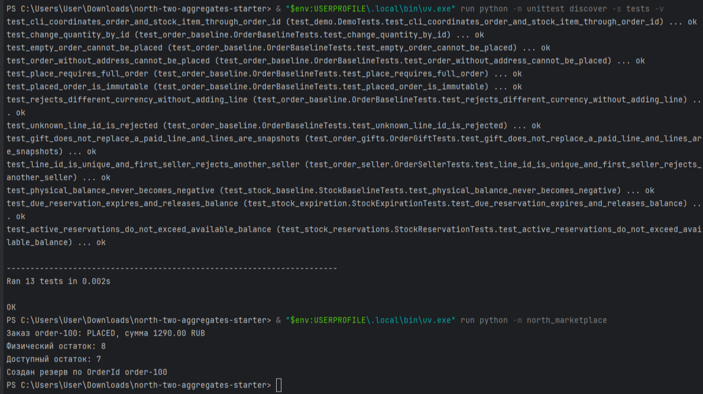

Этап: 1
Изменённые файлы: domain/identifiers.py, domain/values.py, domain/order.py, tests/test_order_baseline.py
Добавленные типы и методы: OrderId, BuyerId, Money, Order, add_paid_line, place
Правило, которое защищает корень: одна валюта; наличие строк и полного адреса для размещения
Успешный сценарий: добавление строки и размещение полного заказа
Негативный сценарий и ожидаемая доменная ошибка: CurrencyMismatchError при добавлении строки в другой валюте; OrderCannotBePlacedError без адреса
Сохраняемые проверки: валюта, пустой заказ, запрет изменений после place
Результат запуска unittest: OK

Этап: 2
Изменённые файлы: domain/identifiers.py, domain/order.py, tests/test_order_seller.py
Добавленные типы и методы: SellerId, проверка уникальности OrderLineId и одного продавца в _attach_line
Правило, которое защищает корень: в заказе могут быть строки только одного продавца
Успешный сценарий: добавление двух строк одного продавца
Негативный сценарий и ожидаемая доменная ошибка: SellerMismatchError при попытке добавить второго продавца; DuplicateOrderLineError при повторном ID
Сохраняемые проверки: проверки этапа 1 + уникальность ID и правило продавца
Результат запуска unittest: OK

Этап: 3
Изменённые файлы: domain/values.py, domain/order.py, tests/test_order_gifts.py
Добавленные типы и методы: LineKind (PAID, GIFT), add_gift_line, проверка в place
Правило, которое защищает корень: подарок имеет нулевую цену; заказ без платной строки нельзя разместить
Успешный сценарий: добавление платной книги и подарка, успешный place
Негативный сценарий и ожидаемая доменная ошибка: GiftPriceError для платного подарка; OrderCannotBePlacedError для заказа только из подарков
Сохраняемые проверки: проверки этапов 1-2 + правила подарков
Результат запуска unittest: OK

Этап: 4
Изменённые файлы: domain/identifiers.py, domain/values.py, domain/stock_item.py, tests/test_stock_baseline.py
Добавленные типы и методы: StockItemId, WarehouseId, StockBalance, StockItem, receive, write_off
Правило, которое защищает корень: физический остаток не может быть отрицательным
Успешный сценарий: приход и списание товара
Негативный сценарий и ожидаемая доменная ошибка: InsufficientPhysicalStockError при списании больше остатка
Сохраняемые проверки: проверки этапов 1-3 + неотрицательность остатка
Результат запуска unittest: OK

Этап: 5
Изменённые файлы: domain/stock_item.py, tests/test_stock_reservations.py
Добавленные типы и методы: StockReservation, ReservationId, reserve, release_reservation, available_quantity
Правило, которое защищает корень: сумма активных резервов не превышает физический остаток
Успешный сценарий: резервирование и освобождение остатка
Негативный сценарий и ожидаемая доменная ошибка: InsufficientAvailableStockError при превышении доступного остатка
Сохраняемые проверки: проверки этапов 1-4 + правило активных резервов
Результат запуска unittest: OK

Этап: 6
Изменённые файлы: domain/values.py, domain/stock_item.py, tests/test_stock_expiration.py, application.py, test_demo.py
Добавленные типы и методы: ReservationDeadline, ReservationStatus.EXPIRED, expire_reservations
Правило, которое защищает корень: доступный остаток учитывает только активные (не истекшие) резервы
Успешный сценарий: истечение резерва по времени и возврат его в доступный остаток
Негативный сценарий и ожидаемая доменная ошибка: InvalidValueError при передаче времени без часового пояса
Сохраняемые проверки: все предыдущие проверки + сценарий истечения
Результат запуска unittest: OK

