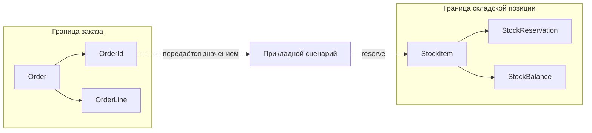
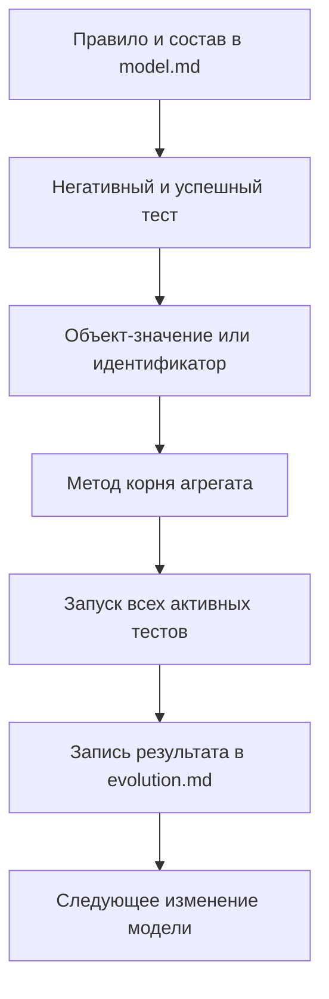
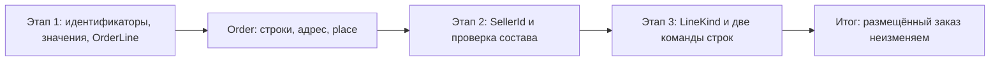
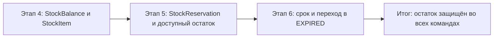
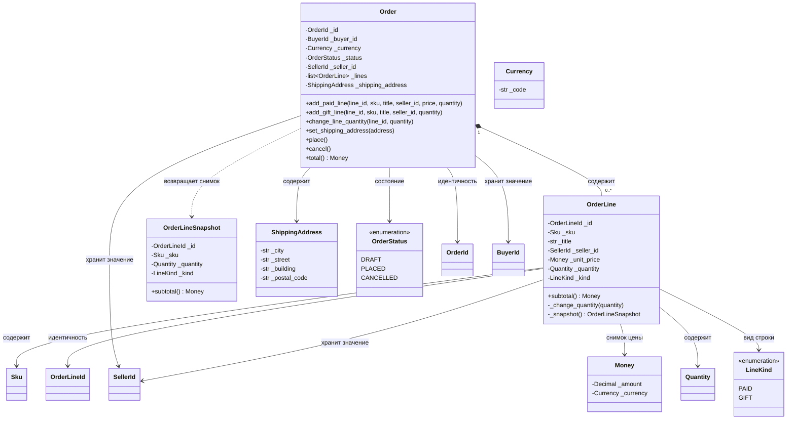
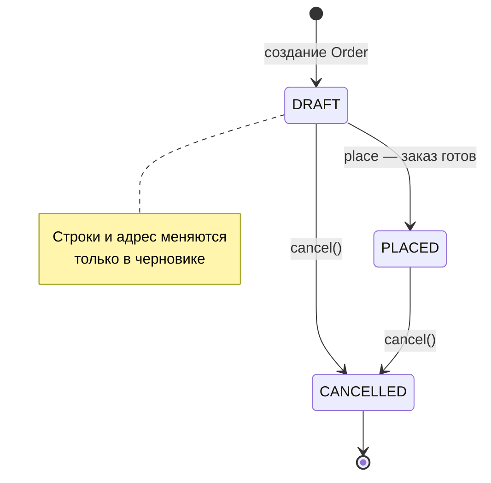
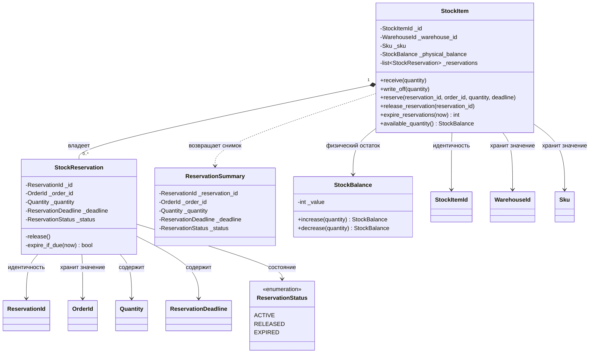
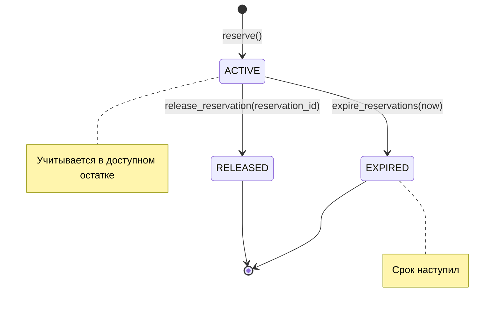
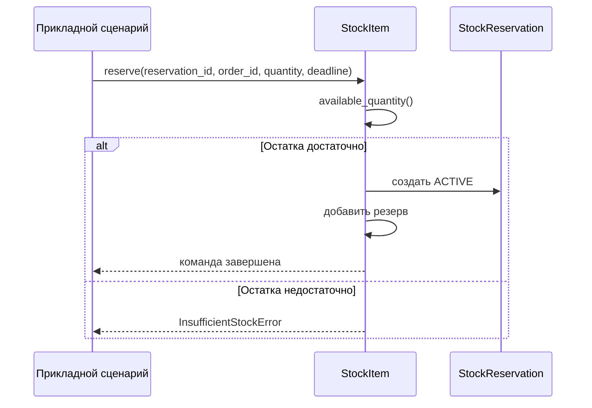
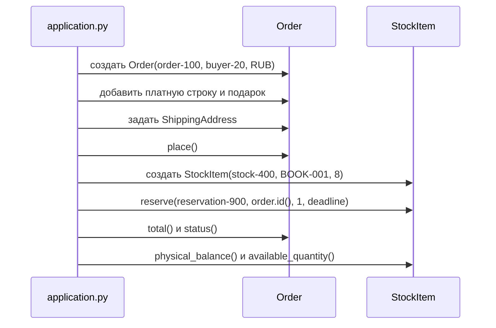

# Целевая модель двух агрегатов

Этот файл фиксирует итоговую предметную модель каркаса. Он описывает границы,
состав, команды и правила. Исходные файлы в `north_marketplace/domain` остаются
пустыми до последовательной реализации шести этапов.

В приложении два агрегата. `Order` отвечает за состав и состояние заказа.
`StockItem` отвечает за физический и доступный остаток одного товара на одном
складе. Каждая команда изменяет состояние только своего корня. Прикладной
сценарий может передать идентификатор заказа в команду складской позиции, но не
передаёт сам объект заказа через границу.



Пунктир обозначает передачу значения `OrderId`. У `StockReservation` нет поля
типа `Order`, доступа к строкам заказа или к его адресу. Размещение заказа, в
свою очередь, не списывает и не резервирует товар автоматически.

## Как переносить модель в код

Схемы задают не украшение документации, а последовательность реализации.
Элемент UML переводится в один конкретный элемент проекта: корень — в класс с
закрытыми полями и предметными методами, композиция — во внутренний список,
объект-значение — в отдельный класс с проверкой конструктора, а переход
состояния — в значение `Enum` и метод корня. Условие у стрелки становится
проверкой до изменения поля; нарушение условия выражается доменной ошибкой.



Композиция `Order *-- OrderLine` переносится в поле `_lines` и закрытый метод
присоединения строки; наружу выдаётся кортеж снимков `OrderLineSnapshot`.
Идентификатор строки проверяется на уникальность до изменения списка. Композиция
`StockItem *-- StockReservation` переносится в `_reservations`; наружу выдаются
снимки `ReservationSummary`. Пунктир `OrderId → прикладной сценарий → StockItem`
переносится в аргумент `order_id` метода `reserve` и явный вызов в
`application.py`. Он не требует импорта `Order` в `stock_item.py`.

## Рабочие потоки реализации

Разработка заказа идёт от неизменяемых частей к корню. На каждом переходе
сохраняются тесты предыдущего состояния: добавление продавца не отменяет
проверку валюты, а добавление подарка не отменяет правило одного продавца.



Для этапа 1 код в `identifiers.py` и `values.py` создаёт допустимые значения,
включая `OrderLineId` и `Currency`, а `order.py` проверяет отношения между ними
и даёт команде `change_line_quantity` доступ к строке по идентификатору. Этап 2 добавляет `SellerId` в
строку и поле корня до присоединения первой строки. Этап 3 добавляет `LineKind`,
конструктор строки и две команды, которые различают цену платной и подарочной
позиции. Модуль `tests/test_order_*.py` после каждого этапа должен содержать
как успешный вызов, так и отказ без изменения заказа.

Разработка складской позиции также начинается с значений, однако её итоговое
правило зависит не от одной команды, а от суммы внутренних резервов.



Этап 4 помещает изменение физического остатка в `receive` и `write_off`.
Этап 5 добавляет внутреннюю сущность, расчёт доступного остатка и освобождение
по `ReservationId`. Этап 6 добавляет `ReservationDeadline` и параметр `now` в
команду истечения. Модуль `tests/test_stock_*.py` закрепляет расчёт остатка и
состояния резерва; `application.py` изменяется только после появления команд
обоих корней.

## 1. Заказ: начало, развитие и итог

### 1.1. Граница и состав

`Order` — корень агрегата. Он создаётся с `OrderId`, `BuyerId` и объектом
значения `Currency`.
`BuyerId` обозначает покупателя вне этой модели и хранится только как
типизированное значение. Состояние заказа составляют строки, адрес доставки,
валюта, продавец и статус. Внешний код не должен добавлять строку в список или
менять статус напрямую; все изменения проходят через методы корня.

`OrderLine` — внутренняя сущность. Её идентичность задаёт `OrderLineId`:
именно по этому значению корень адресно меняет количество конкретной строки.
Строка не является самостоятельным агрегатом: её создаёт, ищет и изменяет
только `Order`. Цена строки — снимок на момент добавления: цена предложения
может измениться позднее, но цена уже сформированной строки не меняется.
Для чтения корень возвращает `OrderLineSnapshot`, а не изменяемую строку.



Композиция `Order *-- OrderLine` означает, что строка принадлежит заказу.
Связи с `BuyerId` и `SellerId` показывают хранение идентификаторов, а не
объектные связи с моделями покупателя и продавца. Адрес, деньги, валюта и количество
также являются объектами-значениями: они проверяются при создании и сравнимы
по своему содержанию.

### 1.2. Три последовательных этапа

Первый этап вводит базовый заказ. Заказ может содержать строки одной валюты,
адрес доставки и состояние черновика. Метод `place()` возможен, когда есть
хотя бы одна строка, полный адрес и положительная итоговая сумма.

Второй этап вводит `SellerId`. При добавлении первой строки корень сохраняет
её продавца в `_seller_id`. Каждая следующая строка проверяется до изменения
списка; строка другого продавца вызывает `SellerMismatchError` и не попадает в
заказ. Это правило принадлежит `Order`, потому что только он видит все строки.

Третий этап вводит `LineKind`. Платная строка имеет `PAID` и положительную
цену. Подарочная строка имеет `GIFT` и нулевую цену. Обе участвуют в правиле
одного продавца, но `place()` требует хотя бы одну платную строку. Заказ,
состоящий только из подарков, не размещается.

| Команда | Изменяемая часть | Предусловие | Постусловие |
|---|---|---|---|
| `add_paid_line` | состав | `DRAFT`, новый `OrderLineId`, совпадают валюта и продавец | добавлена платная строка |
| `add_gift_line` | состав | `DRAFT`, новый `OrderLineId`, совпадает продавец | добавлена строка с нулевой ценой |
| `change_line_quantity` | конкретная строка | `DRAFT`, строка найдена по `OrderLineId` | количество строки заменено |
| `set_shipping_address` | адрес | `DRAFT`, адрес полон | адрес заменён целиком |
| `place` | статус | есть адрес, строки и платная часть | статус `PLACED` |
| `cancel` | статус | заказ ещё не отменён | статус `CANCELLED` |



Начало жизненного цикла заказа — создание черновика. После `place()` состав и
адрес закрыты. `cancel()` переводит черновик или размещённый заказ в
`CANCELLED`; повторная отмена отклоняется. Конец этой границы наступает не при
резервировании, а при завершении её собственных правил: состава, адреса,
валюты, продавца и статуса.

## 2. Складская позиция: начало, развитие и итог

### 2.1. Граница и состав

`StockItem` — корень агрегата складской позиции. Он представляет один `Sku` на
одном `WarehouseId` и имеет идентичность `StockItemId`. Корень владеет
физическим остатком и внутренними резервами. Физический остаток хранится как
`StockBalance` и не может быть отрицательным.

`StockReservation` имеет собственный `ReservationId` и изменяющееся состояние,
поэтому это внутренняя сущность. Она не становится самостоятельным корнем:
создание, освобождение и истечение выполняет `StockItem`. Для чтения корень
возвращает `ReservationSummary`, то есть снимок без методов изменения.



Связь `StockReservation → OrderId` показывает ровно одно поле значения. В
складской позиции нет объекта `Order`, его строк, адреса и методов. Резерв не
удаляется после освобождения или истечения: меняется его статус, благодаря чему
видна история решения в пределах этой складской позиции.

### 2.2. Три последовательных этапа

Четвёртый этап вводит базовую складскую позицию. `receive()` увеличивает
физический остаток, а `write_off()` уменьшает его, не позволяя получить
отрицательное значение.

Пятый этап добавляет `StockReservation`. Корень создаёт резерв по
`ReservationId`, хранит `OrderId`, количество и срок. Сумма активных резервов
не может превышать физический остаток. Освобождение принимает только
`ReservationId`: связь с заказом была зафиксирована при создании и не нужна для
изменения статуса резерва.

Шестой этап добавляет `ReservationDeadline` и истечение. Доступный остаток
вычисляется по формуле:

```text
доступный остаток = физический остаток − сумма активных резервов
```

Время передаётся в `expire_reservations(now)` параметром. Резерв с наступившим
сроком переходит из `ACTIVE` в `EXPIRED` и перестаёт уменьшать доступный
остаток. Уже освобождённый резерв не истекает повторно.





На диаграмме резервирования отсутствует участник `Order`: для команды
достаточно `OrderId`. Прикладной сценарий выбирает момент вызова и передаёт
данные. `StockItem` решает только то, что относится к его границе: достаточен
ли остаток и в каком состоянии находятся его резервы.

## 3. Прикладной сценарий: вызов двух корней

После шестого этапа `application.py` связывает готовые агрегаты одним явным
сценарием. Сначала он создаёт и размещает заказ. Затем создаёт складскую позицию
и передаёт в её команду резервирования только значение `order.id()`. Корни не
вызывают друг друга, а `application.py` не повторяет их проверки.



В прикладном файле этот порядок выражается обычными вызовами. Конструкторы
`OrderLine` и `StockReservation` здесь не используются: их создают методы
корней. Сценарий должен получить результат `PLACED`, сумму `1290.00 RUB`,
физический остаток `8`, доступный остаток `7` и текст о резервировании по
`OrderId`.

```python
rub = Currency("RUB")
order = Order(OrderId("order-100"), BuyerId("buyer-20"), rub)
seller_id = SellerId("seller-7")
order.add_paid_line(OrderLineId("line-1"), Sku("BOOK-001"), "Книга о Севере", seller_id,
                    Money(Decimal("1290.00"), rub), Quantity(1))
order.add_gift_line(OrderLineId("line-2"), Sku("BOOKMARK-001"), "Закладка", seller_id, Quantity(1))
order.change_line_quantity(OrderLineId("line-1"), Quantity(2))
order.set_shipping_address(ShippingAddress("Архангельск", "Поморская", "18", "163000"))
order.place()

stock_item = StockItem(StockItemId("stock-400"), WarehouseId("warehouse-ark"),
                       Sku("BOOK-001"), StockBalance(8))
stock_item.reserve(ReservationId("reservation-900"), order.id(), Quantity(1), deadline)
```

## 4. Итоговая карта ответственности

| Этап | Добавление | Корень команды | Защищаемое правило |
|---|---|---|---|
| 1 | базовый `Order` | `Order` | одна валюта; адрес и строки для размещения |
| 2 | `SellerId` | `Order` | в строках один продавец |
| 3 | `LineKind` | `Order` | подарок нулевой; платная часть обязательна |
| 4 | базовый `StockItem` | `StockItem` | физический остаток неотрицателен |
| 5 | `StockReservation` | `StockItem` | резервы не превышают остаток |
| 6 | `ReservationDeadline` | `StockItem` | доступны только не зарезервированные единицы |

Итог образуют две независимые границы. Заказ защищает состав, адрес и денежную
часть обещания покупателю. Складская позиция защищает остаток и состояние своих
резервов. Их единственная показанная связь — передача `OrderId` прикладным
сценарием; общих изменяемых объектов и автоматического резервирования нет.
